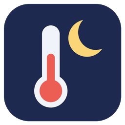

# Nursery Climate

A Home Assistant integration that holds **one room** at a temperature band using a thermostat that lives in **another room**.

Typical case: the thermostat is downstairs, the nursery is upstairs, and a baby monitor (Nanit, etc.) reports the nursery temperature. Nursery Climate watches that sensor and keeps moving the thermostat's setpoint so the *nursery* stays in range, not the hallway.

You pick two things: the room's temperature sensor and the thermostat. Everything else is built in, with no helpers, derivative sensors or automations to wire up.

## Install

1. Copy `custom_components/nursery_climate` into your Home Assistant `config/custom_components/` folder.
2. Restart Home Assistant.
3. **Settings → Devices & services → Add integration → Nursery Climate**.
4. Pick a name (for example "Kids Room"), the room temperature sensor and the thermostat.

Requires Home Assistant 2025.x or newer. Tested on 2026.10 and 2026.11.

### Changing the sensor or thermostat

**Settings → Devices & services → Nursery Climate → ⋮ → Reconfigure**. Pick the new entities and save. Your band, tuning, schedule and on/off state are kept, and control switches to the new entities right away.

To control a second room, add the integration again with that room's sensor.

## Entities

With the name "Kids Room" you get:

| Entity | What it does |
|---|---|
| `switch.kids_room_control` | On = steer the thermostat. Off = hand it back (see below). |
| `time.kids_room_schedule_start` | Control turns on at this time (default 19:00). |
| `time.kids_room_schedule_end` | Control turns off at this time (default 07:00). Set start = end to turn the schedule off. |
| `number.kids_room_low` / `_high` | The band to hold the room in (default 67–70.5 °F). |
| `number.kids_room_kp` / `_kd` | Tuning (default 2.5 / 8). |
| `number.kids_room_hand_back_setpoint` | What the thermostat goes to when control turns off (default 69 °F). |
| `select.kids_room_hand_back_mode` | Thermostat mode when control turns off: `auto` (default), `heat`, `cool` or `off`. |
| `number.kids_room_resting_setpoint` | What the thermostat goes to when the sensor is lost while control is on (default 69 °F). |
| `number.kids_room_sensor_timeout` | Minutes without a good reading before the failsafe kicks in (default 20, 0 = off). |
| `number.kids_room_max_jump` | Biggest believable change between two readings (default 3 °F, 0 = off). |
| `sensor.kids_room_mode` | `off`, `waiting`, `sensor_lost`, `cooling`, `heating` or `in_band`. Attributes: `setpoint`, `rate_per_min`, `room_temp`, `reading_age_min`. |

All settings are editable from the device page and survive restarts. The switch also works from your own automations, for example nap time on/off.

## How it works

Every time the room sensor or the thermostat updates:

```
setpoint = thermostat_temp − Kp × (room_temp − band_middle) − Kd × room_rate
```

- **Above the band:** switch the thermostat to cool. **Below:** switch to heat.
- **Inside the band:** keep the mode and only move the setpoint, so the HVAC eases off before it overshoots.
- **Kp** is how hard it pushes per degree the room is off-center.
- **Kd** brakes using how fast the room is already changing (°F/min over the last 5 minutes).
- The setpoint is clamped to 55–85 °F and only sent when it moves by 0.5° or more, so the thermostat isn't spammed.
- If the thermostat's temperature is missing or outside 40–85 °F, it does nothing and reports `waiting`.

**Tuning:** the room overshoots → raise Kd. The room creeps toward the band edge without correcting → raise Kp.

## Hand-back

When control turns off (switch, schedule end, or your own automation), the thermostat goes to the **Hand-back setpoint** in the **Hand-back mode**:

- **auto:** heat if the house (the thermostat's own reading) is below the hand-back setpoint, cool if it's above. Example: house 65 °F, hand-back 68 °F → heat to 68. If the thermostat is already in heat or cool and the house is within 1 °F of the setpoint, it keeps that mode so a little drift doesn't flip the HVAC.
- **heat** / **cool:** always that mode, at the hand-back setpoint.
- **off:** turn the thermostat off.

A thermostat that is already off stays off, whatever the mode: someone turned it off on purpose. In summer, `auto` can choose heat if the house is cooler than the setpoint at hand-back; set the mode to `cool` for the season if you don't want that.

## Failsafes

Every setting below changes live from the device page. No restart needed.

- **Bad readings are ignored.** `unavailable`, `unknown`, non-numbers and anything outside 40–85 °F are dropped. Control keeps steering on the last good reading.
- **Spikes need a second opinion.** A reading more than **Max jump** away from the last good one is held back. If the next reading lands near it, the room really changed and it's used. If the next reading is back near the old value, the spike is thrown away.
- **Lost sensor → thermostat goes to rest.** If there's no good reading for **Sensor timeout** minutes, Mode becomes `sensor_lost` and the thermostat goes to the resting setpoint. A sensor that freezes on its last value counts as lost too. Control resumes on its own when good readings return.
- A sensor that re-sends the same value still counts as alive. One that only reports when the value changes can trip the timeout in a very stable room: raise the timeout or set it to 0.

To get alerted, write an automation on `sensor.kids_room_mode` changing to `sensor_lost`.

## Limitations

- °F only for now: the clamps and sanity limits are hardcoded in Fahrenheit.
- Assumes a thermostat that supports `heat` and `cool` modes and a single `temperature` setpoint.
- The reference temperature is the thermostat's own `current_temperature`. Some thermostats round it to whole degrees.

## Development

`python3 test_logic.py` checks the control math with plain Python.

## License

MIT
